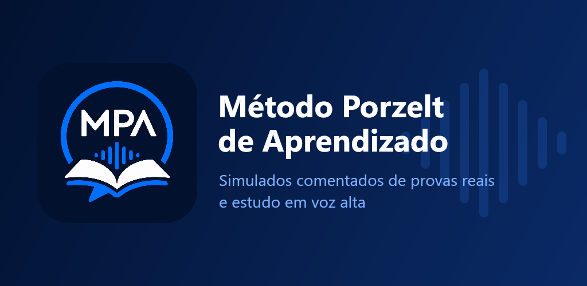

# Case: MPA — Método Porzelt de Aprendizado



> App Android próprio com fins comerciais. O código é privado; este case mostra o problema, a arquitetura e as decisões técnicas. Demonstração ao vivo disponível em entrevista.

## O problema
Quem estuda para concursos policiais aprende melhor **respondendo em voz alta** e encontra pouco material de questões **comentadas a partir de provas reais**. Os apps existentes são genéricos, cheios de anúncios ou dependem de IA respondendo sem revisão.

## A solução
Um app com duas partes:
1. **Estudo pessoal, gratuito e 100% offline:** o aluno cadastra matérias e questões dissertativas, **grava a resposta em áudio** e ouve depois. Inclui um editor de redação com trilha guiada (12 cartões com dicas e análise heurística em tempo real).
2. **Simulados comentados, por assinatura:** banco de questões autorais de provas reais, organizado por concurso e com comentários revisados.

## Arquitetura

```
App (React Native + Expo + TypeScript)
 ├── SQLite local ── conteúdo pessoal, progresso, redações (offline-first)
 ├── expo-audio ──── gravação e reprodução das respostas
 ├── Google Play Billing (expo-iap) ── assinatura com teste grátis
 └── HTTPS ──► Cloudflare Worker ──► R2 (bucket privado) + KV
                 │  valida a assinatura, aplica limite diário
                 │  entrega questões pagas uma a uma
                 └─ pacotes públicos por matéria para a amostra grátis

Pipeline de conteúdo (Node.js)
 content/<concurso>/<matéria>/<id>.json  ──►  gerar-pacote  ──►  publicar (S3 API)
   • imagens convertidas para WebP (sharp), com cache
   • índice versionado por hash: o app baixa só o que mudou
```

## Decisões técnicas de destaque
- **Conteúdo novo sem app novo:** questões são publicadas no bucket e chegam ao app sem build nem revisão da loja.
- **Sincronização incremental:** índice com versão/hash por matéria; o import usa *upsert* por origem, sem duplicar e preservando o progresso do aluno.
- **Proteção do conteúdo pago no edge:** bucket privado, com o Worker como único ponto de acesso, verificação de assinatura e limite de requisições por dia.
- **Funil de conversão no produto:** amostra grátis por concurso, contador de questões liberadas e convite ao fim da amostra.
- **Lógica de domínio pura e testável** (ex.: análise de redação) separada dos componentes de UI.
- **Distribuição:** EAS Build (`.aab`), versionamento por `versionCode`, faixa de teste interno na Google Play.

## Stack
React Native 0.86 · React 19 · TypeScript · Expo SDK 57 · expo-router · expo-sqlite · expo-audio · expo-iap · Cloudflare Workers, R2 e KV · Wrangler · Node.js · sharp · AWS SDK S3 · EAS

## Status
Em teste interno na Google Play, com assinatura e teste grátis validados de ponta a ponta.

[← voltar ao perfil](https://github.com/Porzelt)
